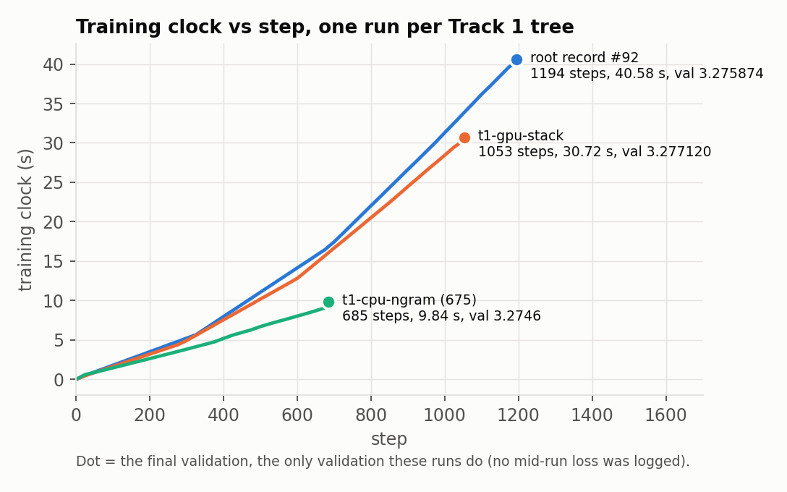
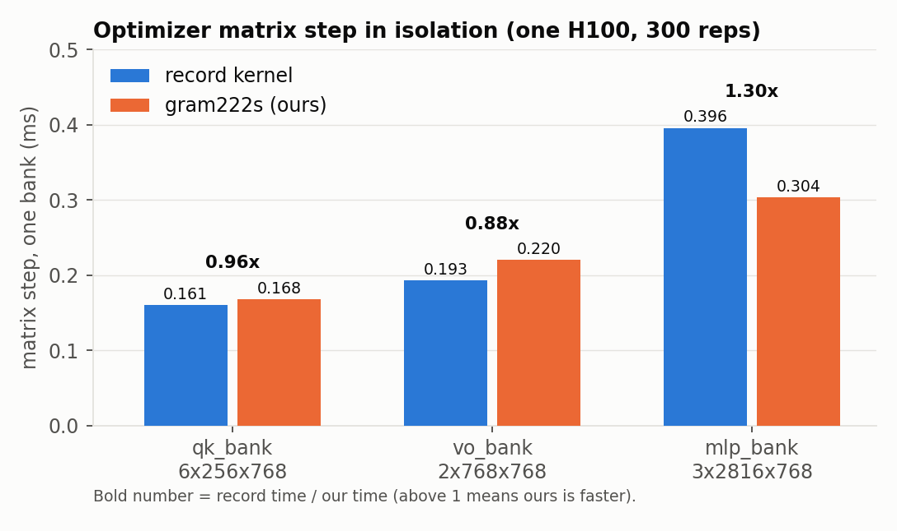
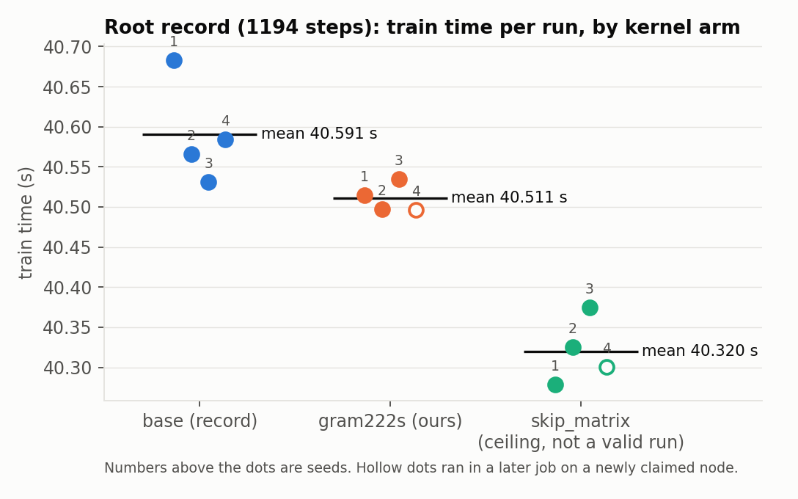
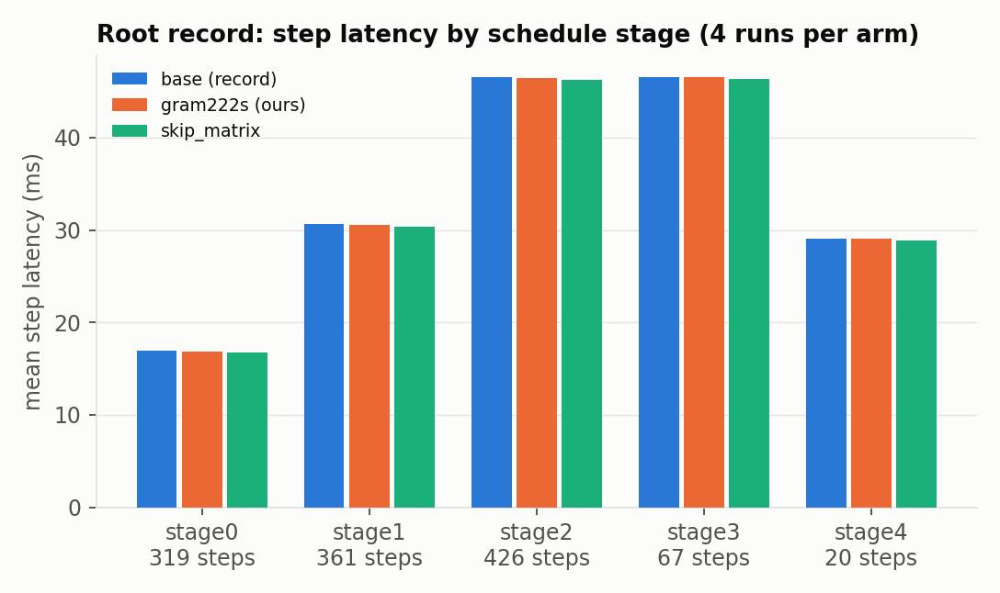
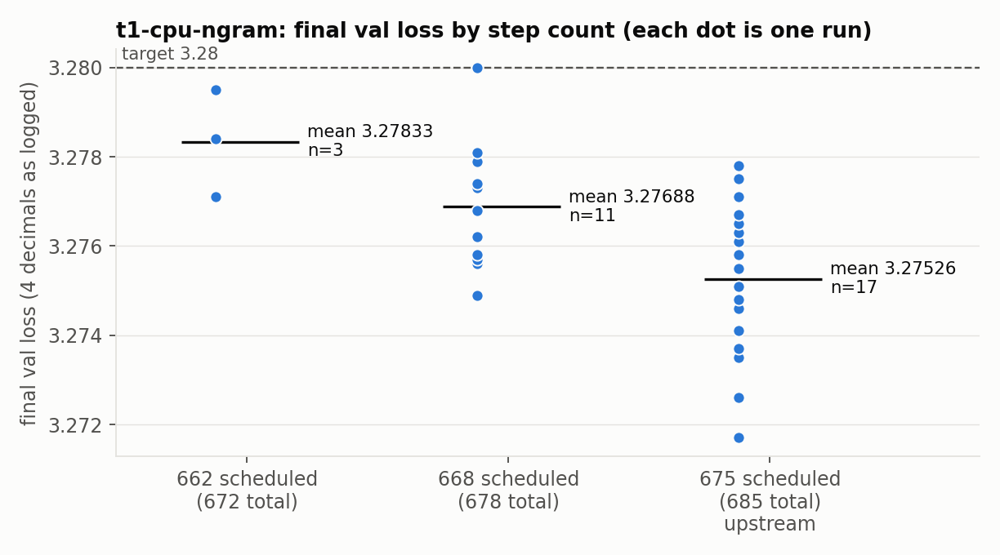
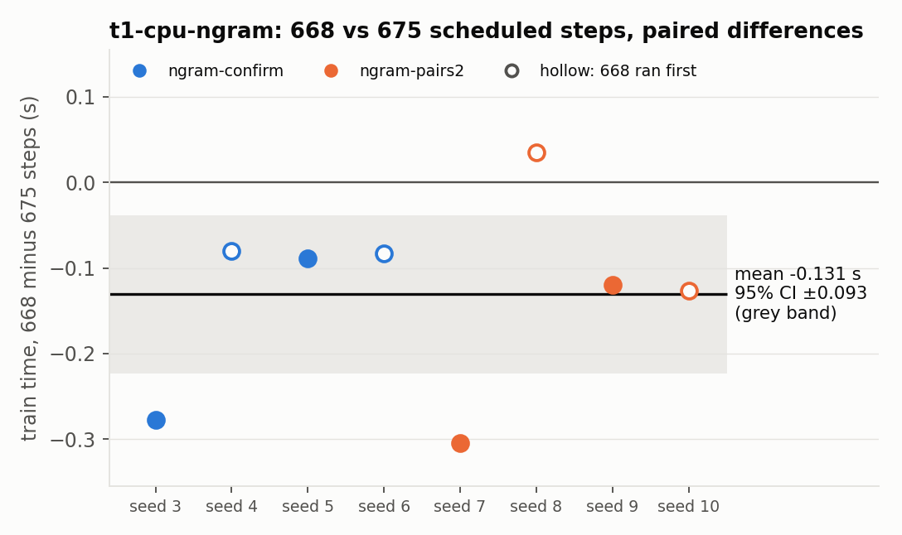
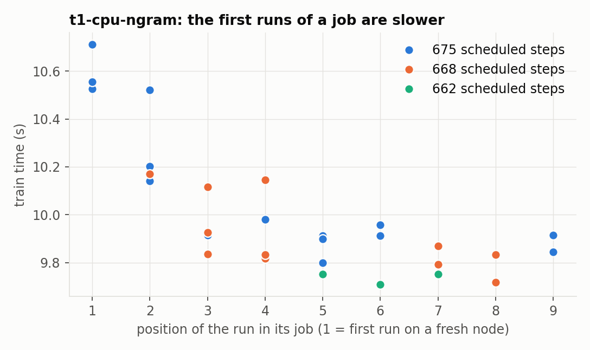
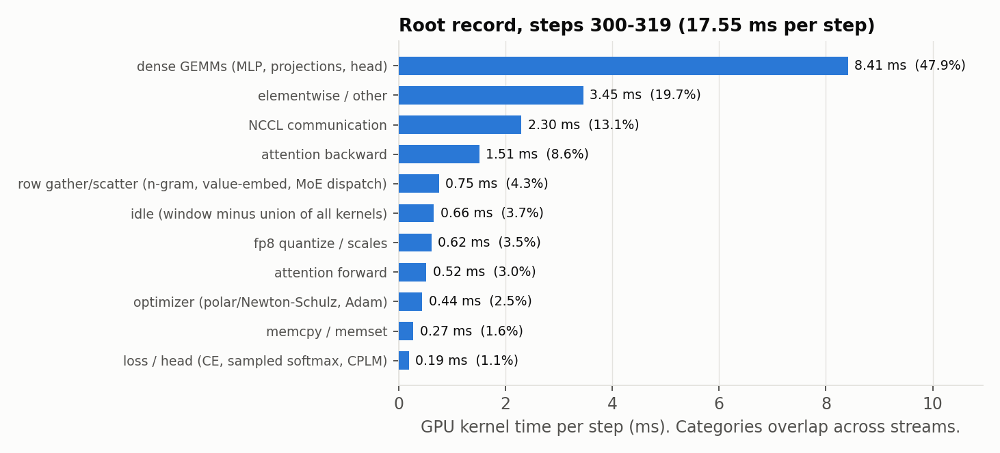

# 182 results: what we ran, what it shows, where every number comes from

This folder is the write-up source for the report. Everything here was parsed from the logs in `raw/` by
`make_tables.py`. If a number in this file and a log disagree, the log wins: fix the script and rerun it.

| File | What it is |
|---|---|
| `README.md` | This file. Plain-language results, conclusions and caveats. |
| `tables.md` | All summary tables, generated. The tables below are copied from it. |
| `runs.csv` | One row per training run (58 rows). The `log` column names the raw log of each run. |
| `figures/*.png` | Eight report-ready figures, generated. |
| `raw/` | The small text logs (2 MB). `raw/MANIFEST.txt` lists what was copied and what was skipped. |
| `make_tables.py` | Rebuilds `runs.csv`, `tables.md` and `figures/` from `raw/`. |
| `collect_raw.py` | How `raw/` was copied from the submitting laptop, with redaction. You do not need to run it. |

## 1. What was run, and on what

- **Hardware.** 8 x NVIDIA H100 80GB (HBM3), Intel Xeon Platinum 8481C, 208 CPUs, 1843 GiB RAM. Rented through Lor.
  Each batch job claims a node, runs, and releases it. So "our node" means the same node type, claimed seven
  times (one interactive bring-up session and six batch jobs), not one machine kept for the whole day.
- **Software.** torch 2.10.0+cu128 (CUDA 12.8), triton 3.6.0, Python 3.12.3, NVIDIA driver 580.178.04, NCCL 2.27.5.
  The versions are pinned by `182/tools/node_setup.sh`. Proof: `raw/jobs/*/out/session/env/stack.json`, `raw/jobs/*/out/setup.log`.
- **When.** 2026-11-19 07:38 UTC to 2026-11-20 01:17 UTC.
- **Cost.** The six batch jobs used 32.82 GPU-hours and cost $65.64 (`raw/jobs/*/job.json`). The bring-up session is not in that total.
- **Runs.** 51 training runs in `runs.csv`: 50 valid, 1 failed before training.
- **Timing.** Every time below is the trainer's own `train_time`, the number the speedrun uses. It excludes compile and warm-up.

| Session | Commit | What it ran |
|---|---|---|
| `bringup-1119` (interactive) | `0b6e64e` | Kernel microbenchmark, unit tests, 10 root-record runs (kernel A/B, seeds 1-4) |
| `fastest-1` | `2411736` | 2 runs of t1-gpu-stack, a profiled root run, 3 runs of t1-cpu-ngram, the last 2 kernel A/B runs (seed 4) |
| `ngram-ab` | `791b9ca` | t1-cpu-ngram: base vs `TABLE_VOTE=1`, 3 pairs |
| `ngram-steps` | `0f35786` | t1-cpu-ngram: one 675-step run, then 668 and 662 scheduled steps, 3 seeds each |
| `ngram-confirm` | `2d77c1e` | t1-cpu-ngram: warm-up run, then 4 interleaved pairs of 675 vs 668 |
| `ngram-final` | `66dc47f` | t1-cpu-ngram pairs **did not run** (see 3.5). One Track 2 run of t2-cpu-ngram, which is valid. |
| `ngram-pairs2` | `ce16269` | t1-cpu-ngram: warm-up run, then 4 more interleaved pairs of 675 vs 668 |

The job scripts are `182/lor/jobs/*.sh`. Each `raw/jobs/<job>/log.txt` shows what the job printed.

## 2. Headline table

Target: val loss at or under 3.28 (Track 1) or 2.92 (Track 2). The official Track 1 record is 39.9 s and the official
Track 2 record is 1041 s; those are upstream's numbers on upstream's machine, not ours.

| tree / config | runs | mean time (s) | sd | min | max | mean val loss | sd | worst val loss | runs at or under target | peak GPU mem allocated (MiB) | loop ms/step | METRIC mean step (ms) |
|---|---|---|---|---|---|---|---|---|---|---|---|---|
| root record #92, baseline | 4 | 40.591 | 0.065 | 40.531 | 40.683 | 3.27609 | 0.00066 | 3.276999 | 4 | 48413 | 33.667 | 33.544 |
| root, ANVIL_KERNEL=gram222s (ours) | 4 | 40.511 | 0.018 | 40.496 | 40.535 | 3.27553 | 0.00074 | 3.276415 | 4 | 48413 | 33.595 | 33.445 |
| t1-gpu-stack (upstream PR #397 tree) | 2 | 30.719 | 0.000 | 30.719 | 30.719 | 3.27692 | 0.00028 | 3.277120 | 2 | 34310 | 28.802 | - |
| t1-cpu-ngram, 675 scheduled steps (upstream PR #381), all runs | 17 | 10.170 | 0.321 | 9.798 | 10.711 | 3.27526 | 0.00173 | 3.2778 | 17 | 49531 | 13.544 | - |
| t1-cpu-ngram, 675, without each job's first run | 12 | 10.000 | 0.200 | 9.798 | 10.522 | 3.27483 | 0.00180 | 3.2778 | 12 | 49531 | 13.538 | - |
| t1-cpu-ngram, 668 scheduled steps (our trim), all runs | 11 | 9.914 | 0.156 | 9.717 | 10.170 | 3.27688 | 0.00146 | 3.2800 | 11 | 49531 | 13.553 | - |
| t1-cpu-ngram, 668, interleaved-pair runs only | 8 | 9.828 | 0.060 | 9.717 | 9.925 | 3.27727 | 0.00146 | 3.2800 | 8 | 49531 | 13.545 | - |
| t2-cpu-ngram (Track 2, target 2.92) | 1 | 221.988 | - | 221.988 | 221.988 | 2.87856 | - | 2.878556 | 1 | 50482 | 38.132 | - |

How to read it:

- `loop ms/step` is the training clock at the last step divided by the step count. Every tree logs it.
- `METRIC mean step` is the mean of per-step latencies. Only the root tree logs it (with `RUN_METRICS=1`).
- Root rows report peak memory as the maximum over the 8 GPUs during the timed loop. The variant rows report what the
  trainer prints at the end, for GPU 0.
- The two t1-gpu-stack runs really do log the same time to the millisecond (30719 ms). Two runs is not a spread.
- The first run of a tree on a fresh node is slow. That is why two 675-step rows are shown. See 3.4.



## 3. Experiments

### 3.1 Does our Gram-space ANVIL kernel make the record faster?

**Question.** ANVIL is the optimizer of record #92. Each step it does matrix work on three weight banks. We wrote a
second way to compute the same update (`ANVIL_KERNEL=gram222s`, design in `182/optim-kernel/README.md`). Is it
faster in isolation? Does the full run get faster? How much could any optimizer kernel save at most?

**Commands.**

```bash
python 182/optim-kernel/bench.py --json kbench.json          # the kernel alone, one GPU
python -m pytest 182/optim-kernel/test_optim_kernel.py -q    # unit tests
# one full run; three arms, seeds 1-4:
RUN_METRICS=1 TRAIN_SEED=$seed                           torchrun --standalone --nproc_per_node=8 train_gpt.py   # base
RUN_METRICS=1 TRAIN_SEED=$seed ANVIL_KERNEL=gram222s     torchrun --standalone --nproc_per_node=8 train_gpt.py   # ours
RUN_METRICS=1 TRAIN_SEED=$seed ANVIL_ABLATE=skip_matrix  torchrun --standalone --nproc_per_node=8 train_gpt.py   # ceiling
```

`ANVIL_ABLATE=skip_matrix` skips the matrix work entirely. It is a measurement, not a training method: its loss is
about 3.455, far over the target. The time it saves is the most any faster optimizer kernel could save.

**The kernel alone** (one H100, 300 repetitions; `raw/bringup-1119/bench.log`). Only the largest bank (`mlp_bank`) gets faster:

| what | bank | kernel | shape | record ms | alt ms | speedup | record err vs exact | alt err vs exact | alt vs record (Frobenius) |
|---|---|---|---|---|---|---|---|---|---|
| matrix | qk_bank | gram222s | 6x256x768 | 0.1605 | 0.168 | 0.9551 | 0.60% | 0.67% | 0.89% |
| matrix | vo_bank | gram222s | 2x768x768 | 0.1925 | 0.22 | 0.8752 | 0.48% | 0.62% | 0.78% |
| matrix | mlp_bank | gram222s | 3x2816x768 | 0.3957 | 0.3036 | 1.303 | 0.77% | 0.69% | 1.03% |
| update | mlp_bank | gram222s | 3x2816x768 | 0.5102 | 0.4734 | 1.078 | - | - | 1.02% |
| matrix | mlp_bank | gram33 | 3x2816x768 | 0.3939 | 0.3155 | 1.249 | 0.77% | 1.02% | 1.28% |

- `matrix` is the matrix part only. `update` is the whole optimizer update for that bank.
- So the matrix step of `mlp_bank` is 1.30x faster (0.3957 to 0.3036 ms). The whole `mlp_bank` update is 1.08x faster (0.5102 to 0.4734 ms).
- Accuracy is the same as the record's: 0.69% from the exact update, against the record's 0.77%.
- All three banks together cost 0.8779 ms per step. Of that, 0.5926 ms is matrix work. That is 0.7075 s over 1194 steps if none of it overlaps other GPU work.
- The bench predicts our kernel saves 0.0921 ms per step of matrix work, or 0.11 s per run, if fully exposed.
- The full table (4 kernels, 3 banks) is section C of `tables.md`.



**Full runs** (1194 steps each; every run is listed in section B1 of `tables.md`):

| arm | n | train time by seed 1-4 (s) | mean (s) | sd | val loss by seed 1-4 | mean val loss | sd | mean step (ms) |
|---|---|---|---|---|---|---|---|---|
| base | 4 | 40.6828 / 40.5660 / 40.5309 / 40.5843 | 40.5910 | 0.0651 | 3.275422 / 3.276999 / 3.276056 / 3.275874 | 3.276088 | 0.000663 | 33.544 |
| gram222s | 4 | 40.5149 / 40.4974 / 40.5346 / 40.4962 | 40.5108 | 0.0180 | 3.274867 / 3.276415 / 3.274970 / 3.275853 | 3.275526 | 0.000740 | 33.445 |
| skip_matrix | 4 | 40.2783 / 40.3254 / 40.3744 / 40.3003 | 40.3196 | 0.0413 | 3.448960 / 3.451657 / 3.462739 / 3.457042 | 3.455099 | 0.006101 | 33.294 |

Paired by seed (arm minus base):

| difference | pairs | mean Δtime (s) | sd | se | t | 95% CI | p (two-sided) | mean Δval loss | se | t | 95% CI | p (two-sided) |
|---|---|---|---|---|---|---|---|---|---|---|---|---|
| gram222s - base, seeds 1-4 | 4 | -0.080 | 0.071 | 0.035 | -2.27 | ±0.112 | 0.1075 | -0.00056 | 0.00022 | -2.58 | ±0.00069 | 0.0817 |
| gram222s - base, seeds 1-3 (all on the bring-up node) | 3 | -0.078 | 0.086 | 0.050 | -1.56 | ±0.214 | 0.2591 | -0.00074 | 0.00017 | -4.30 | ±0.00074 | 0.0500 |
| gram222s - base, seeds 2-4 (drops the node's first run) | 3 | -0.051 | 0.048 | 0.028 | -1.83 | ±0.120 | 0.2093 | -0.00056 | 0.00031 | -1.83 | ±0.00132 | 0.2083 |
| gram222s - base, seeds 2-3 (same node, no first run) | 2 | -0.032 | 0.051 | 0.036 | -0.90 | ±0.459 | 0.5343 | -0.00083 | 0.00025 | -3.33 | ±0.00319 | 0.1859 |
| skip_matrix - base, seeds 1-4 | 4 | -0.271 | 0.103 | 0.052 | -5.25 | ±0.164 | 0.0134 | +0.17901 | 0.00306 | 58.49 | ±0.00974 | 0.0000 |
| skip_matrix - base, seeds 2-4 (drops the node's first run) | 3 | -0.227 | 0.065 | 0.037 | -6.07 | ±0.161 | 0.0261 | +0.18084 | 0.00348 | 52.04 | ±0.01495 | 0.0004 |



**Honest conclusion.**

- In isolation the kernel works: 1.30x on the matrix step of the largest bank, at the record's accuracy.
- End to end it is 0.080 s faster on average (40.511 s against 40.591 s). The 95% interval is ±0.112 s and includes zero (p = 0.11). **We cannot claim an end-to-end speedup from 4 seeds.**
- The loss did not get worse (mean difference -0.00056, interval ±0.00069). Peak memory is unchanged (48413 MiB).
- The ceiling is small. Skipping the matrix work entirely saves 0.271 s (±0.164). The bench says that work is 0.7075 s if nothing overlaps it, so most of it is hidden behind other GPU work. No optimizer-kernel change can save more than about 0.27 s of a 40.6 s run.
- The profile agrees: the optimizer is 2.5% of GPU kernel time in the profiled steps (3.6).

**Caveats.**

- Base seed 1 was the first training run on the node, and it is the slowest base run (40.6828 s). First runs are slower (3.4). Without seed 1 the gain is 0.051 s (3 pairs) or 0.032 s (2 pairs). The 0.080 s is likely an overestimate.
- Seed 4 of gram222s and skip_matrix ran about 10 hours later, in the `fastest-1` job on a newly claimed node. Base seed 4 ran in the bring-up session. That pair is not a same-session pair.
- The arms were not run in a balanced order. Base always ran first within a seed.
- One unit test failed on the GPU: `test_gpu_kernels_match_cpu_reference[gram33]` (1 failed, 56 passed; `raw/bringup-1119/test.log`). It is the `gram33` variant, not `gram222s`. Its error was 6.3% against a 2.0% limit. The bench shows the same thing for `gram33` on `qk_bank` (6.50% from exact). We did not train with `gram33`.
- In the bench, switching all three banks makes the full update slower than the record's (`tables.md` C: the kernel loses on `qk_bank` and `vo_bank`). Only `mlp_bank` is switched, which is the default.
- Step latencies are host-side readings without a GPU sync. Means over many steps are sound. Single-step values (p95, max) are not.

Step latency by schedule stage, mean over the 4 runs of each arm (ms):

| arm | all | stage0 | stage1 | stage2 | stage3 | stage4 |
|---|---|---|---|---|---|---|
| base | 33.544 | 16.937 | 30.653 | 46.590 | 46.570 | 29.065 |
| gram222s | 33.445 | 16.891 | 30.525 | 46.470 | 46.501 | 29.038 |
| skip_matrix | 33.294 | 16.767 | 30.383 | 46.292 | 46.336 | 28.873 |
| steps counted | 1193 | 319 | 361 | 426 | 67 | 20 |



**Follow-up (2026-11-21): the step loop shows the saving; the noise is outside it.** Added by hand from the
`METRIC step_latency scope=all` and `METRIC val` lines of the nine same-session logs in `raw/bringup-1119/` (seeds 1-3);
not yet generated by `make_tables.py`. Step loop = 1193 timed steps x mean step time. Remainder = `train_time` minus that.

| seed | base: loop (s) / remainder (s) | gram222s: loop / remainder | skip_matrix: loop / remainder | gram222s - base, loop (ms/step) | skip_matrix - base, loop (ms/step) |
|---|---|---|---|---|---|
| 1 | 40.028 / 0.655 | 39.930 / 0.585 | 39.734 / 0.544 | -0.082 | -0.246 |
| 2 | 40.017 / 0.549 | 39.937 / 0.561 | 39.758 / 0.567 | -0.067 | -0.217 |
| 3 | 39.997 / 0.534 | 39.933 / 0.601 | 39.760 / 0.614 | -0.053 | -0.198 |

- The step loop is very repeatable: base varies by 0.031 s across the three runs, gram222s by 0.007 s.
- In the step loop, gram222s is faster in all three seeds: -0.067 ms/step on average (se 0.008, t = -8.0, 2 degrees of
  freedom, p about 0.015), which is 0.080 s per run. skip_matrix is -0.220 ms/step, 0.263 s per run.
- The remainder (about 0.55 s that the clock covers outside the 1193 timed steps) varies by 0.12 s between runs and
  does not depend on the arm. It is the reason whole-run `train_time` cannot resolve the kernel's effect at n = 4.
- So the kernel's saving is real and about 0.2% of the run. Caveats: three seeds, base always ran first (base itself
  drifts 0.03 s over the session, less than the 0.06 to 0.10 s difference), and step times are host-side readings.
- Why the saving is small although the arithmetic drops from 104 to 71 GFLOP: at these sizes the kernels are
  latency-bound. From the `prim.*.mlp_bank` rows of `bench.log`: a Gram of the 2816x768 matrices takes 0.022 ms, a
  large product 0.022 to 0.030 ms, a 768x768 product 0.014 to 0.016 ms. A small product has 27% of the arithmetic of
  a large one but about 60% of its time. And the bench's 1.30x compares the matrix sequences only (the record's
  sequence re-implemented call by call); the 1.08x (0.5102 to 0.4734 ms) is the whole bank update as the trainer runs
  it, with momentum, normalization and the weight update. Both are timed as CUDA-graph replays.

**Second session (2026-11-21, job `kernel-ab2`, a second node; logs in `raw/jobs/kernel-ab2-1121-152359/`).** Added by
hand from the `METRIC` lines; `182/paper/make_figs.py` reads these logs for `fig_paired.png` and `fig_curve.png`.
`make_tables.py` also includes this job: `runs.csv` rows with experiment `kernel_ab2` / `val_curve`, and section B2b of `tables.md`.

| run | order | train time (s) | val loss | mean step (ms) | step 0 (ms) | tail after last step (ms) |
|---|---|---|---|---|---|---|
| curve base, seed 5 (`VAL_CURVE=150`, cold) | 1 | 41.4994 | 3.273281 | 32.655 | 1103.6 | 266.2 |
| curve gram222s, seed 5 (`VAL_CURVE=150`) | 2 | 40.5003 | 3.274384 | 32.603 | 166.1 | 272.3 |
| gram222s, seed 6 | 3 | 40.4851 | 3.276890 | 33.387 | 258.6 | 395.3 |
| base, seed 6 | 4 | 40.4479 | 3.277197 | 33.446 | 158.2 | 389.2 |
| base, seed 7 | 5 | 40.4353 | 3.276937 | 33.442 | 145.7 | 392.7 |
| gram222s, seed 7 | 6 | 40.3800 | 3.276107 | 33.379 | 156.4 | 402.1 |
| skip_matrix, seed 6 | 7 | 40.1823 | 3.453502 | 33.235 | 151.4 | 381.5 |

- Curve runs are not timing runs (their clock carries the extra validations; the first also has a cold first step).
- Paired step-time difference against base, all sessions: gram222s -0.082, -0.067, -0.053 (seeds 1-3), -0.059, -0.063
  (seeds 6-7): mean -0.065 ms, se 0.005, t = -13.3, n = 5, 0.077 s per run. skip_matrix -0.246, -0.217, -0.198, -0.211:
  mean -0.218 ms, se 0.010, n = 4, 0.260 s per run.
- In the second session the run order was swapped between seeds (gram222s first for seed 6, base first for seed 7),
  and the difference is the same in both orders.
- Whole-run time is again noisier than the step loop: seed 6 has gram222s 0.037 s slower in `train_time` because its
  step 0 took 259 ms instead of about 155 ms.
- The time outside the step loop is about 0.15 s up to the end of step 0 and about 0.39 s after the last step.
  Upstream PR #404 reports the same two pieces (170 ms and 370 ms) and removes most of them.
- Val loss over six seeds each (1-4, 6, 7): base 3.276414 (sd 0.000726), gram222s 3.275850 (sd 0.000801).
- Validation curve, seed 5 (step: base / gram222s): 150: 4.868323 / 4.881268; 300: 4.509883 / 4.539740;
  450: 4.166049 / 4.128518; 600: 3.826226 / 3.861896; 750: 3.569143 / 3.577977; 900: 3.477052 / 3.472386;
  1050: 3.355637 / 3.356091; 1194: 3.273281 / 3.274384.
- Cost of this job: $10.63. Total Lor spend: $98.10 of $100.

**Third session (2026-11-22 05:12 to 07:33 UTC, Q Labs Slurm job 13354, one node `odin5-gpu-018`, 8x H100; logs in
`raw/jobs/qlabs-13354/`).** Everything below is generated: `runs.csv` rows with experiment `kernel_ab3` (timing runs and
the warm-up) and `curve3` (curve runs), and sections B2c, C2, C3 and D2 of `tables.md`. `182/paper/make_figs.py` imports
`make_tables.py` for `fig_paired.png`, `fig_curve.png`, `fig_sweep.png` and `fig_profile_late.png`.

- Software: torch 2.10.0+cu128 (CUDA 12.8 build), triton 3.6.0, NCCL 2.27.5, as before, and the same system
  CUDA 13.1 toolkit. The NVIDIA driver differs: 580.126.09 here, 580.178.04 on the Lor nodes (`node_report.txt`, `setup.log`).
- What ran, in order (`slurm.out`): the size sweep of the microbenchmark (`sweep.log`, `sweep.json`), the standard
  microbenchmark (`bench.log`, `kbench.json`), six curve runs (`root-curve-{base,gram222s}-s{5,6,7}.log`, `VAL_CURVE=150
  TRAIN_LOSS_EVERY=25`), one discarded warm-up (`root-time-warmup-s99.log`), 18 timing runs
  (`root-time-{base,gram222s,skipmatrix}-s{8..13}.log`, arm order rotated through all six permutations), curve runs of
  `gram33s` (seeds 5, 6, 7) and `gram42s` (seeds 5, 6), and a profile of 20 steps from step 900 (`profile-late/`).
- Timing, seeds 8-13, savings against the record at the same seed: gram222s 0.047 ms per step (se 0.009, n = 6),
  skip_matrix 0.204 ms (se 0.005); whole-run train time 0.046 s (se 0.021) and 0.264 s (se 0.021).
- All sessions, the same ten seeds for both arms (1, 2, 3, 6, 8-13): gram222s 0.054 ms per step (se 0.006, t = 8.6),
  0.065 s per run; skip_matrix 0.209 ms (se 0.005), 0.250 s per run. Whole-run train time: 0.047 s (se 0.021, p = 0.049)
  and 0.265 s (se 0.022). Seed 7's kernel pair is not in this set because seed 7 has no ablation run.
- Val loss over the 12 timing seeds (1-4, 6-13): base 3.276963 (sd 0.001102), gram222s 3.276310 (sd 0.001159).
- `gram33s` (three maps per restart): seed 5 diverged (training loss NaN at the step-400 read, last finite read at step
  375; validation NaN from step 450); seeds 6 and 7 finished at 3.276379 and 3.277907. `gram42s` (four maps chained):
  both runs failed the step-graph self-check in the warm-up, before training (`replay loss nan != eager nan`).
  These three runs are in `runs.csv` with valid=0.
- The curve runs' clocks carry the extra validations and loss reads; they are never used for timing.
- `METRIC train loss=` is rank 0's training objective summed over its tokens of that step. Tables and figures divide it
  by the tokens per rank of the step's stage (16384 / 32768 / 49152 / 40960 / 16384). It is the weighted training
  objective (sampled softmax plus auxiliary terms), not a next-token cross-entropy.
- Size sweep: 116 rows measured; 16 further cases (the full-update and ablate cases of the four largest shapes) raised
  torch.compile's recompile limit in the benchmark harness and have no row. See C2.
- `job.json` of this job was written by hand (there is no Lor record); it has GPU-hours from the job's own timestamps
  and no price. `raw/MANIFEST.txt` and `collect_raw.py` cover the Lor jobs only; this folder was copied in as it is.

### 3.2 Do the fast upstream trees reproduce on our node?

**Question.** Upstream has open pull requests that are much faster than the record. Do they reach the target on our node, and in what time?

**Command.** `bash 182/gpu_session.sh env sanity t1gpu t1cpu profile bundle` (job `fastest-1`), and `bash 182/gpu_session.sh env t2cpu bundle` (job `ngram-final`). Seeds are random in these runs.

**Results.** See the headline table. In short:

- `variants/t1-gpu-stack` (PR #397): 30.719 s twice. Val loss 3.276719 and 3.277120. Peak memory 34310 MiB.
- `variants/t1-cpu-ngram` (PR #381, 675 scheduled steps): 17 runs across five jobs, mean 10.170 s. Mean 10.000 s without each job's first run. Every run was under 3.28; the worst was 3.2778.
- `variants/t2-cpu-ngram` (Track 2): one run, 221.988 s, val loss 2.878556, 5800 steps, peak memory 50482 MiB.

**Honest conclusion.** They reproduce. On our node the upstream CPU-retrieval tree trains to the Track 1 target in about 10 s, against 40.6 s for the record. This is upstream's work, measured by us. It is not our speedup.

**Caveats.**

- t1-gpu-stack: 2 runs. Track 2: 1 run. No spread, no significance.
- t1-cpu-ngram needs a large host: it reports 308 GiB of host memory for rank 0 and 144 GiB of `/dev/shm`. It uses the CPUs for retrieval during training.
- t1-cpu-ngram logs the val loss to 4 decimals only.

### 3.3 TABLE_VOTE=1 on t1-cpu-ngram

**Question.** Does the `TABLE_VOTE=1` option change the time or the loss?

**Command.** `AB_RUNS=3 bash variants/t1-cpu-ngram/182/run_node.sh ab` (job `ngram-ab`, `182/lor/jobs/ngram_ab.sh`). Arm A is the default. Arm B adds `TABLE_VOTE=1`. Same seed within a pair, 675 scheduled steps.

| order | arm | seed | flags | train time (s) | val loss |
|---|---|---|---|---|---|
| 1 | A | 0 | (base) | 10.711 | 3.2755 |
| 2 | B | 0 | TABLE_VOTE=1 | 10.395 | 3.2746 |
| 3 | B | 1 | TABLE_VOTE=1 | 10.070 | 3.2727 |
| 4 | A | 1 | (base) | 9.981 | 3.2726 |
| 5 | A | 2 | (base) | 9.913 | 3.2737 |
| 6 | B | 2 | TABLE_VOTE=1 | 9.948 | 3.2744 |

| difference | pairs | mean Δtime (s) | sd | se | t | 95% CI | p (two-sided) | mean Δval loss | se | t | 95% CI | p (two-sided) |
|---|---|---|---|---|---|---|---|---|---|---|---|---|
| TABLE_VOTE=1 - base | 3 | -0.064 | 0.220 | 0.127 | -0.50 | ±0.546 | 0.6642 | -0.00003 | 0.00047 | -0.07 | ±0.00201 | 0.9496 |

Each `TABLE_VOTE=1` run also scores the same trained weights three ways:

| seed | val loss with the table's links | without them | with PR #399's fixed vote |
|---|---|---|---|
| 0 | 3.27457 | 3.27464 | 3.27614 |
| 1 | 3.27273 | 3.27264 | 3.27412 |
| 2 | 3.27439 | 3.27425 | 3.27576 |

**Honest conclusion.** No effect. The links change the loss by +0.00005 (±0.00027). PR #399's fixed vote makes it worse by +0.00150 (±0.00004).

**Caveat.** 3 pairs. The time numbers mostly show the job warming up (10.711 s first, 9.948 s last), not the flag.

### 3.4 How many scheduled steps can go? (675 to 668 to 662)

**Question.** Upstream PR #381 schedules 675 steps (685 in total). Can we train fewer steps and still reach 3.28?

**Commands.** `NUM_SCHEDULED_ITERATIONS=668` (or `662`) in front of the trainer. Jobs: `ngram-steps` (sweep), then `ngram-confirm` and `ngram-pairs2` (interleaved pairs: `AB_A="NUM_SCHEDULED_ITERATIONS=675" AB_B="NUM_SCHEDULED_ITERATIONS=668" bash variants/t1-cpu-ngram/182/run_node.sh ab`, after one warm-up run).

**Val loss by step count** (every valid run, all jobs):

| scheduled steps | total steps | runs | distinct seeds | mean val loss | sd | best | worst | margin under 3.28 | t (margin / se) | p (one-sided, mean < 3.28) | runs at or under 3.28 |
|---|---|---|---|---|---|---|---|---|---|---|---|
| 675 | 685 | 17 | 13 | 3.27526 | 0.00173 | 3.2717 | 3.2778 | 0.00474 | 11.30 | 2.5e-09 | 17 |
| 668 | 678 | 11 | 11 | 3.27688 | 0.00146 | 3.2749 | 3.2800 | 0.00312 | 7.09 | 1.7e-05 | 11 |
| 662 | 672 | 3 | 3 | 3.27833 | 0.00120 | 3.2771 | 3.2795 | 0.00167 | 2.40 | 0.069 | 3 |



**Time: 675 vs 668, interleaved pairs** (same seed, back to back, order alternating):

| job | seed | ran first | 675: time (s) | 675: val loss | 668: time (s) | 668: val loss | Δtime 668-675 (s) | Δval loss 668-675 |
|---|---|---|---|---|---|---|---|---|
| ngram-confirm-1119-150812 | 3 | 675 | 10.203 | 3.2767 | 9.925 | 3.2779 | -0.278 | +0.0012 |
| ngram-confirm-1119-150812 | 4 | 668 | 9.898 | 3.2758 | 9.818 | 3.2774 | -0.080 | +0.0016 |
| ngram-confirm-1119-150812 | 5 | 675 | 9.958 | 3.2751 | 9.869 | 3.2773 | -0.089 | +0.0022 |
| ngram-confirm-1119-150812 | 6 | 668 | 9.915 | 3.2778 | 9.832 | 3.2800 | -0.083 | +0.0022 |
| ngram-pairs2-1119-162744 | 7 | 675 | 10.141 | 3.2735 | 9.836 | 3.2756 | -0.305 | +0.0021 |
| ngram-pairs2-1119-162744 | 8 | 668 | 9.798 | 3.2741 | 9.833 | 3.2762 | +0.035 | +0.0021 |
| ngram-pairs2-1119-162744 | 9 | 675 | 9.913 | 3.2761 | 9.793 | 3.2781 | -0.120 | +0.0020 |
| ngram-pairs2-1119-162744 | 10 | 668 | 9.844 | 3.2746 | 9.717 | 3.2757 | -0.127 | +0.0011 |

| difference | pairs | mean Δtime (s) | sd | se | t | 95% CI | p (two-sided) | mean Δval loss | se | t | 95% CI | p (two-sided) |
|---|---|---|---|---|---|---|---|---|---|---|---|---|
| 668 - 675, ngram-confirm-1119-150812 | 4 | -0.132 | 0.097 | 0.049 | -2.73 | ±0.154 | 0.0719 | +0.00180 | 0.00024 | 7.35 | ±0.00078 | 0.0052 |
| 668 - 675, ngram-pairs2-1119-162744 | 4 | -0.129 | 0.139 | 0.069 | -1.86 | ±0.221 | 0.1599 | +0.00182 | 0.00024 | 7.52 | ±0.00077 | 0.0049 |
| 668 - 675, all pairs | 8 | -0.131 | 0.111 | 0.039 | -3.33 | ±0.093 | 0.0125 | +0.00181 | 0.00016 | 11.35 | ±0.00038 | 0.0000 |
| 668 - 675, without each job's first pair (job positions 2-3) | 6 | -0.077 | 0.058 | 0.024 | -3.24 | ±0.061 | 0.0229 | +0.00187 | 0.00018 | 10.47 | ±0.00046 | 0.0001 |

Expected from the step count alone: 7 fewer steps x 13.533 ms/step = 0.095 s.



**Honest conclusion.**

- 668 scheduled steps is faster than 675 by 0.131 s on average over 8 pairs (se 0.039, 95% interval ±0.093, p = 0.0125). 668 was faster in 7 of 8 pairs.
- It still reaches the target. Over 11 seeds the mean val loss is 3.27688, which is 0.00312 under 3.28 (one-sided p = 1.7e-05). All 11 runs were at or under 3.28.
- The margin is thin. Trimming 7 steps costs +0.00181 of val loss (±0.00038). One 668 run logged 3.2800, exactly the target at 4 decimals.
- 662 is too far: 3 runs, mean 3.27833, and the test against 3.28 does not pass (p = 0.069).
- So the trim is a real, small gain: about 0.1 s of a 10 s run, paid for with about a third of the loss margin.

**Caveats.**

- **Run order matters.** The first runs of a job are slower, then times settle (table and figure below). In both pair jobs the first pair ran 675 first, right after the warm-up run, and those two pairs give the largest differences (-0.278, -0.305). Without them the difference is 0.077 s over 6 pairs (±0.061, p = 0.023). The step count alone predicts 0.095 s. Report the gain as "about 0.08 to 0.13 s".
- The 3 sweep runs at 668 came early in their job (positions 2-4) and are slow for that reason (10.115 to 10.170 s). Use the pair runs for 668's time (mean 9.828 s) and all 11 runs for its loss.
- The same seed does not give the same result twice in this tree. The two warm-up runs used seed 20 with default settings and logged 3.2771 and 3.2775. Seed pairing removes only part of the noise.
- The one-sided test treats the runs as independent. We have not submitted anything upstream.
- The val loss is logged to 4 decimals in this tree, so the means carry rounding of up to 0.00005 per run.

| position of the run in its job | runs | mean time (s) | min | max |
|---|---|---|---|---|
| 1 | 5 | 10.579 | 10.525 | 10.711 |
| 2 | 3 | 10.289 | 10.141 | 10.522 |
| 3 | 1 | 9.914 | 9.914 | 9.914 |
| 4 | 1 | 9.981 | 9.981 | 9.981 |
| 5 | 3 | 9.870 | 9.798 | 9.913 |
| 6 | 2 | 9.936 | 9.913 | 9.958 |
| 9 | 2 | 9.880 | 9.844 | 9.915 |

(675-step runs only.)



### 3.5 The failed job part (`ngram-final`)

The job prepared `variants/t1-cpu-ngram`, then prepared `variants/t2-cpu-ngram` in the background. Both trees install
their own build of the `exact_match` extension into the same Python environment. The second build replaced the first.
The Track 1 warm-up run then failed its pre-flight check ("FAIL exact_match: an older build") and the pairs never
started (`raw/jobs/ngram-final-1119-160156/out/ab.log`, `log.txt`).

- The failed warm-up is in `runs.csv` with `valid=0`. It has no time and no loss.
- No 675-vs-668 pair from this job exists. Do not count any.
- The Track 2 run in the same job is valid. It ran after its own tree's prep and passed its check.

### 3.6 Where does a step's time go? (profile of the root record)

**Command.** `PROFILE_TREES=root bash 182/gpu_session.sh profile` (in job `fastest-1`). It uses torch.profiler on all 8 ranks for 20 steps (steps 300 to 319).

steps profiled: 20 (device 0); GPU window 17.55 ms/step, CPU step 14.00 ms; busy 16.89 ms, idle 0.66 ms (3.7%)

| category | ms/step | % of step |
|---|---|---|
| NCCL communication | 2.297 | 13.1% |
| attention backward | 1.513 | 8.6% |
| attention forward | 0.519 | 3.0% |
| optimizer (polar/Newton-Schulz, Adam) | 0.442 | 2.5% |
| dense GEMMs (MLP, projections, head) | 8.410 | 47.9% |
| fp8 quantize / scales | 0.616 | 3.5% |
| loss / head (CE, sampled softmax, CPLM) | 0.190 | 1.1% |
| row gather/scatter (n-gram, value-embed, MoE dispatch) | 0.752 | 4.3% |
| memcpy / memset | 0.273 | 1.6% |
| elementwise / other | 3.454 | 19.7% |
| idle (window minus union of all kernels) | 0.658 | 3.7% |

NCCL: 2.297 ms/step of kernels, 0.074 ms exposed (not under any compute kernel); 97% overlapped



**Honest conclusion.** Dense matrix multiplies are about half of the GPU time. The optimizer is 2.5%. Communication is 13.1% but 97% of it overlaps compute. The GPU is idle 3.7% of the time. This explains 3.1: there is little optimizer time to save.

**Caveats.**

- The profile covers only steps 300 to 319. Those are in the first schedule stage, where a step takes 17.55 ms. The run's mean step is 33.5 ms, and later stages take 46.6 ms. The shares may differ in later stages.
- Categories overlap across CUDA streams. They can add up to more than 100%.
- The profiled run is not a timing run (40.798 s, val loss 3.2771 with the profiler attached). It is in `runs.csv` with `role=profile`.
- This is torch.profiler output, not an nsys trace.

## 4. What is ours and what is upstream's

**Prior art for the kernel (checked 2026-11-21).** The Gram-space evaluation is described in an appendix of the Polar Express paper (arXiv 2505.16932, "Fast Polynomial Iteration for Rectangular Matrices"): compute Y = X^T X once, iterate on Y and an accumulated Q, return X Q, and restart from X every few iterations because of bfloat16 round-off (it discusses a restart interval of 3). So the idea is not ours. Ours: the implementation inside the ANVIL2 trainer with restarts every 2 maps, the symmetric small-product kernel, the numerical check on the record's shapes, and the end-to-end and ceiling measurements. In the current version (v5, Appendix J and J.1, read 2026-11-21 from arxiv.org/html/2505.16932v5) the authors also apply it to Muon on GPT-Small / FineWeb1B with a restart after three iterations: loss changes by about 0.01, "the runtimes of all 12 runs were nearly identical", and they conclude "the FLOP savings of Algorithm 3 is not beneficial" and that it "may be more impactful when using a larger model". (An earlier version said preliminary bfloat16 experiments were not successful; that is superseded.) So our end-to-end result replicates theirs in the ANVIL2 trainer; what we add is the explanation (ceiling, overlap, launch-bound kernels). **Also (found 2026-11-21): Gram Newton-Schulz** (Zhang, Amsel, Chen, Dao, 2026, tridao.me/blog/2026/gram-newton-schulz, code at github.com/Dao-AILab/gram-newton-schulz) is the same method with a restart after two iterations and symmetric GEMM kernels (alpha*A*B + beta*C for symmetric operands), i.e. the same design choices as our gram222s. It reports 40-50% off the orthogonalization step on large models, where Newton-Schulz is 2-17% of wall-clock. So neither the Gram-space order, the two-map restart, nor the symmetric small-product kernel is new. What remains ours: the port into the ANVIL2 trainer and the measurements. **Sources for the two upstream PRs cited in the report (read from the PR text with `gh pr view`, 2026-11-21):** PR #393's table has the row "four-map ANVIL cascade (lets the expert bank run at margin 1.1) | -0.19 s | equal"; PR #404's description says "-0.35 s of exact host-side fixes", "Tail: 370 ms -> ~30 ms after the GPU drains" and "Start: clock -> step 0 queued, 170 ms -> 44 ms". The Polar Express v5 appendix says "these changes had a negligible effect in this setting" and "the runtimes of all 12 runs were nearly identical"; the Gram Newton-Schulz post attributes the divergence to negative eigenvalues in half precision and restarts after two iterations. The ceiling is 0.26 s of 40.59 s = 0.64%, written as 0.6% (earlier notes said 0.7%). **More prior work, checked 2026-11-22:** (1) Symmetric kernel: Quack's CuTeDSL `gemm_symmetric` (github.com/Dao-AILab/quack, used by Gram Newton-Schulz) already computes alpha*A@B + beta*C on one triangle with a mirrored store, for two different operands, batched. Our `anvil_chain.py` is the record's `ba_plus_cAA_kernel` with a second operand: about 5-6 of 61 kernel lines change meaning; it is a small Triton port, not a new kernel design. (2) Reusing the previous step's orthogonalization: CacheMuon (Dev, Bohara, Takac, Horvath, arXiv:2606.16371, 15 Jun 2026; abstract: "reuses information from previous optimization steps to approximate the polar factor at the current step") and Transport Muon (Ethan Smith, Substack, 28 Apr 2026: keeps the previous polar factor, full Newton-Schulz every N steps, a tangent update plus one Newton-Schulz step in between). Both pages were opened and the titles, authors and dates confirmed; detailed numbers were not verified. We did not test either. **Two statements in the report about upstream submissions, with their sources (read with `gh`, 2026-11-21):** PR #393's title is "Track 1: MoE and other tricks on top of #379 + #375 + #371" and PR #404's is "Track 1: #397 + exact tail/startup speedups + truncated attention backward", and both are open (hence "both stacked on other open submissions"). On PR #367 a repository collaborator wrote on 2026-10-03 that he will "set up some rules" on CPU use "so that we don't see run-away CPU farms"; no rule had been posted by 2026-11-21 (hence "rules on CPU use are still to be set").

Be exact about this in the report.

**Upstream's work (we ran it; we did not invent it):**

- The root tree is the official record #92 (ANVIL2), 39.9 s officially. We measured 40.591 s on our node.
- `variants/t1-gpu-stack` is the tree of open upstream PR #397. We measured 30.719 s.
- `variants/t1-cpu-ngram` is the tree of open upstream PR #381, which builds on PR #380 (the exact-count chain, by devenpzak) and PR #367 (exact-match retrieval, by hermabr). We measured about 10.0 s at its own 675 steps.
- `variants/t2-cpu-ngram` is PR #380's stack with the Track 2 sizes that ldmberman posted in the #380 thread. We measured 221.988 s in one run.
- **The step from 40.6 s to about 10 s, and the 222 s Track 2 time, are almost entirely these contributors' work.**

**Our work:**

1. **The Gram-space ANVIL kernel** (`ANVIL_KERNEL=gram222s`), its benchmark and its tests. 1.30x on the largest bank's matrix step in isolation. About 0.08 s end to end, which is inside run-to-run noise at 4 seeds. The measured ceiling for any such kernel is 0.27 s.
2. **The measurement ceiling** (`ANVIL_ABLATE=skip_matrix`). It shows how much optimizer time is exposed at all.
3. **The 668-step trim** of t1-cpu-ngram. About 0.1 s faster (0.131 s over 8 pairs; 0.077 s without the first pair of each job). Statistically supported. Thin loss margin.
4. **The negative result on `TABLE_VOTE`.** No effect.
5. **The measurement tooling**: `RUN_METRICS=1` (step latency, peak memory, full-precision loss on the root tree), the profiler session, the Lor job scripts, and this archive.
6. **Independent reproduction** of four upstream trees on one node type with a pinned stack, with repeated runs.

## 5. How the numbers map to the proposal's metrics

| Proposal metric | Where it is | Value |
|---|---|---|
| Kernel latency | 3.1, `tables.md` C, `figures/kernel_bench.png` | `mlp_bank` matrix step 0.3957 ms to 0.3036 ms (1.303x); whole `mlp_bank` update 0.5102 to 0.4734 ms (1.078x) |
| Step latency | Headline table, 3.1 stage table, `figures/step_latency_by_stage.png` | Root: 33.544 ms mean (base), 33.445 ms (gram222s). t1-gpu-stack 28.802, t1-cpu-ngram 13.544, Track 2 38.132 ms (clock / steps) |
| Peak GPU memory | Headline table, `runs.csv` columns `peak_alloc_mib`, `peak_reserved_mib` | Root 48413 MiB (same with gram222s). t1-gpu-stack 34310. t1-cpu-ngram 49531. Track 2 50482 |
| Val loss vs steps | 3.4, `figures/val_loss_by_steps.png` | Final val loss at 662 / 668 / 675 scheduled steps: 3.27833 / 3.27688 / 3.27526 |
| Val loss vs wall-clock | Headline table, `figures/train_time_vs_step.png` | Final val loss against train time for each tree. See the limit below. |
| Time to 3.28 | Headline table | Each run's train time, for runs that end at or under 3.28. Root 40.591 s, t1-gpu-stack 30.719 s, t1-cpu-ngram 10.000 s (675, without each job's first run) and 9.828 s (668, pair runs). Track 2: 221.988 s to 2.92 |
| Repeated runs | `runs.csv`, every table | 4 seeds per arm on the root; 17 runs at 675 and 11 seeds at 668 on t1-cpu-ngram; 2 runs of t1-gpu-stack; 1 run of Track 2 |

**Limit: there were no loss curves in the first session (validation curves were added in the second session; see 3.1).** Every run validated once, at the end. No run used `VAL_CURVE`. So:

- "Val loss vs steps" is the final loss of separate runs trained for different step counts. It is not a curve within one run.
- "Val loss vs wall-clock" is the final loss against the total train time, plus the training clock against the step number.
- "Time to 3.28" is the full run time of runs that end under 3.28. That is the speedrun's own definition. It is not interpolated from a curve.
- A within-run curve needs new runs with `VAL_CURVE=N` on the root tree. That path has not run on a GPU yet (`182/README.md`).

## 6. How to regenerate

```bash
python3 182/results/make_tables.py     # rewrites runs.csv, tables.md and figures/ from raw/
```

- Needs Python 3.8 or newer. No packages are needed for `runs.csv` and `tables.md`. The figures need matplotlib and are skipped without it.
- It takes a few seconds on a laptop.
- To check a number by hand: find the run in `runs.csv`, open the file in its `log` column, and search for `val_loss`.
- To add new runs: put the new job's logs under `raw/jobs/<job>/` in the same layout and rerun. New job folders need an entry in `collect_runs()` only if they use a new layout.
- `collect_raw.py` rebuilds `raw/` from `~/.lor-182/` on the laptop that submitted the jobs. It drops binaries, files over 200 kB (the trainers' full logs, which start with a dump of the trainer source), duplicate copies, and the submit-side job specs. It redacts tokens, keys and email addresses. `raw/MANIFEST.txt` records all of it.

## 7. What the logs do not contain

- No mid-run validation losses in the first session (see section 5); the second and third sessions have curve runs (3.1).
- No full-precision val loss for t1-cpu-ngram (4 decimals). The root tree, t1-gpu-stack and Track 2 log 6 decimals.
- No per-step latency lines or all-GPU peak memory for the variant trees. They log the clock every 25 steps and GPU 0's peak memory.
- No nsys trace. The profile is torch.profiler.
- No end-to-end run of `gram222` or `gram33`. `gram222s` was trained in every session; `gram33s` and `gram42s` only in the third session's curve runs (3.1).
- No baseline root run inside the `fastest-1` job, so seed 4 of the kernel A/B has no same-session base.
- The exact shell command of the 10 bring-up runs is not in the logs. Each log does record its seed, `RUN_METRICS=1` and the kernel flag in effect.
- The full trainer logs (about 700 kB each, mostly a copy of the trainer source) are not in `raw/`. The console files next to them have every result line. The commit of each job is in `raw/jobs/<job>/out/sha`.
